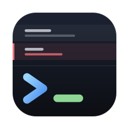
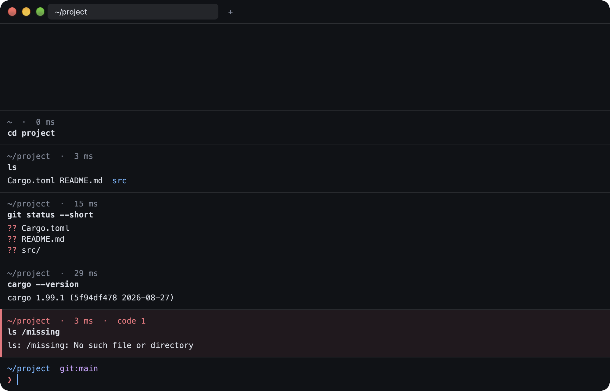
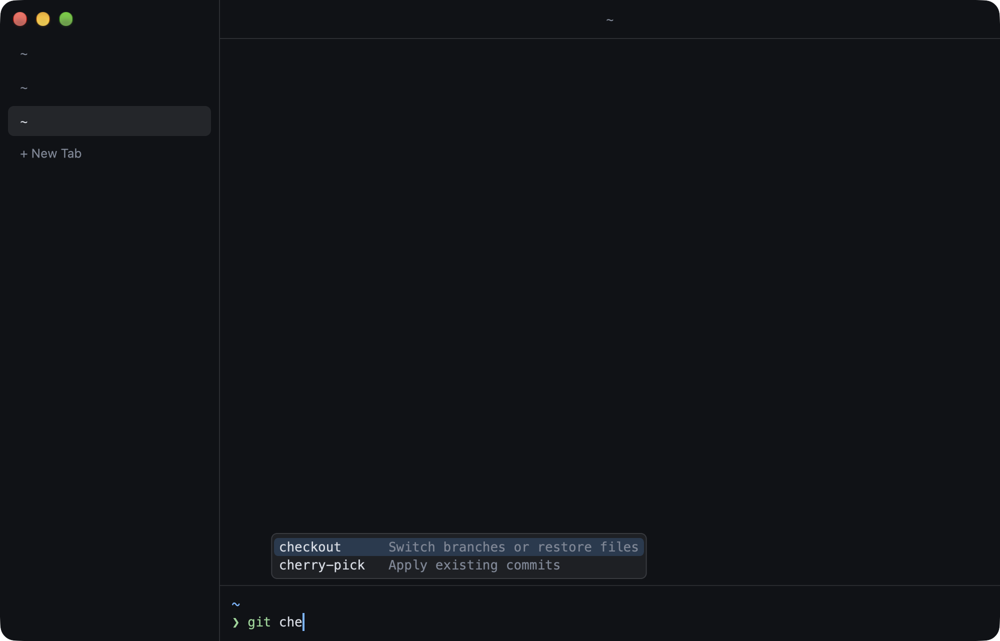
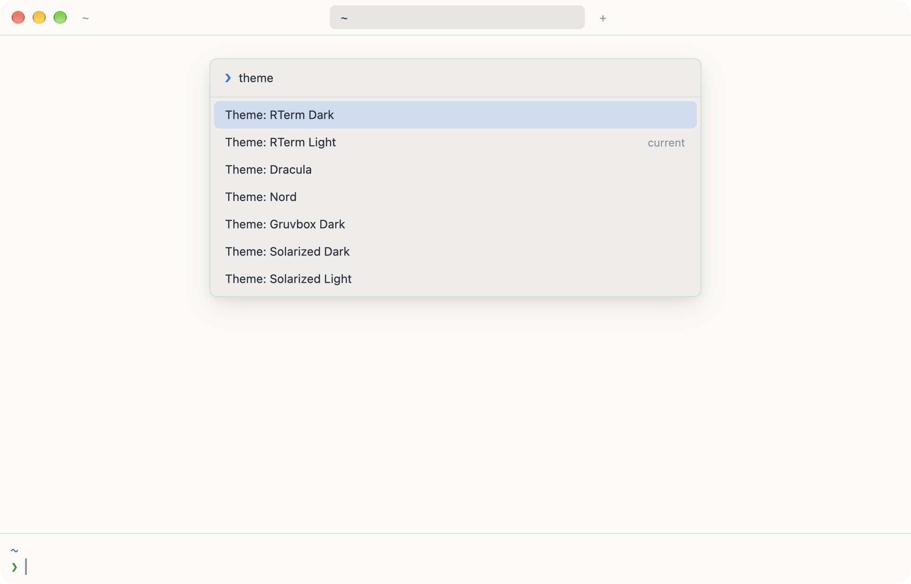

<div align="center">



# RTerm

**A modern terminal that stays on your machine.**

Command blocks, a real text editor for your input, completion, a command
palette — with no account, no cloud and no AI.

[Download](../../releases/latest) · [Features](#features) · [Configuration](#configuration) · [Build from source](#build-from-source)

</div>



## Why

Modern terminals have made the command line much nicer to use: output grouped
per command, an input area that behaves like an editor, completion with
descriptions. Too often that comes bundled with a sign-in screen, cloud sync
and an AI subscription.

RTerm keeps the first part and drops the second:

- **No account.** There is nothing to sign in to.
- **No cloud.** Your history and settings are plain files in
  `~/.config/rterm/`. The only network request RTerm makes is asking GitHub
  whether a new version exists, and you can turn it off.
- **No AI.** Completion comes from your `PATH`, your shell and small local
  description files.

It is written in Rust on top of [GPUI](https://www.gpui.rs) (the GPU-accelerated
UI framework behind Zed) and [`alacritty_terminal`](https://crates.io/crates/alacritty_terminal)
for terminal emulation.

## Features

### Blocks

Each command and its output form a block, with the directory it ran in, how
long it took and its exit code. Failed commands stand out in red. Click a block
to select it, drag to select text, `Cmd+C` to copy.

Full-screen programs such as `vim`, `less` or `htop` take over the whole pane,
then hand it back to the block list when they exit.

### An input editor, not a prompt

The command line is a small multi-line text editor: mouse selection, word
motions, undo and redo, `Shift+Enter` for a new line. It highlights what you
type as you type it — known commands in green, unknown ones in red, strings,
options, variables, and existing paths underlined — using the aliases and
functions of your own shell.

### Completion and history



- `Tab` completes commands, files, git branches, and subcommands and options
  (with descriptions) for `git`, `cargo`, `npm`, `docker` and `brew`.
- `Ctrl+R` searches your history. Commands run in RTerm remember their
  directory, exit code and duration.

### Tabs, splits and a command palette



- Tabs at the top or in a column on the left, your choice.
- Split any pane to the right or downwards.
- `Cmd+Shift+P` opens the command palette: every action, every theme and your
  workflows, searchable.

### Workflows

Commands you keep retyping, with blanks to fill in. They are TOML files in
`~/.config/rterm/workflows/`:

```toml
[[workflow]]
name = "Who is listening on a port"
description = "Finds the process holding a port"
command = "lsof -nP -iTCP:{{port}} -sTCP:LISTEN"
arguments = { port = 3000 }
```

Pick one from the palette and it lands in the editor with its first parameter
selected; `Tab` jumps to the next one.

### Themes

Seven built-in themes — RTerm Dark, RTerm Light, Dracula, Nord, Gruvbox Dark,
Solarized Dark and Solarized Light. By default RTerm follows macOS's light or
dark mode, with a theme for each; pick **Manual** in Settings to keep a single
one. Add your own as `~/.config/rterm/themes/<name>.toml`.

## Install

RTerm currently runs on **macOS 11 or later**, on Apple Silicon and Intel.

1. Download `RTerm-<version>-macos-universal.dmg` from the
   [latest release](../../releases/latest).
2. Open it and drag **RTerm** into **Applications**.

### First launch

RTerm is signed, but not with a paid Apple Developer ID and it is not
notarized, so macOS asks for confirmation the first time:

- **macOS 15 and later:** open RTerm once (macOS refuses), then go to
  **System Settings → Privacy & Security**, scroll down and click
  **Open Anyway**.
- **Earlier versions:** right-click RTerm in Applications and choose **Open**,
  then **Open** again.

Or skip the dialog altogether from a terminal:

```bash
xattr -dr com.apple.quarantine /Applications/RTerm.app
```

You only need to do this once: later versions install themselves (see
[Updates](#updates)) and do not ask again.

### Updates

RTerm checks this repository's releases at launch and then once a day. When a
new version is out, an **Update to …** button appears in the tab bar: click it
to download and install it, then **Restart to Update** (or simply quit; the
next launch uses the new version). **RTerm → Check for Updates…** checks right
away.

Nothing is installed without a click. To stop the automatic check, add this to
`config.toml`:

```toml
[updates]
check = false
```

RTerm must be in a folder you can write to (`/Applications` is fine on a
single-user Mac) to replace itself.

## Keyboard shortcuts

| Action | Shortcut |
| --- | --- |
| Command palette | `Cmd+Shift+P` or `Cmd+P` |
| New window | `Cmd+N` |
| New tab | `Cmd+T` |
| Next / previous tab | `Ctrl+Tab` / `Ctrl+Shift+Tab` |
| Go to tab 1–9 | `Cmd+1` … `Cmd+9` |
| Split right / down | `Cmd+D` / `Cmd+Shift+D` |
| Next / previous pane | `Cmd+Option+→` / `Cmd+Option+←` |
| Close pane | `Cmd+W` |
| Complete | `Tab` |
| Search history | `Ctrl+R` |
| New line in the editor | `Shift+Enter` |
| Clear blocks | `Cmd+K` |
| Font size | `Cmd+=` / `Cmd+-` / `Cmd+0` |
| Settings | `Cmd+,` |

The editor also understands the usual readline keys (`Ctrl+A`, `Ctrl+E`,
`Ctrl+K`, `Ctrl+U`, `Ctrl+W`) and macOS text shortcuts (`Option+←/→`,
`Cmd+←/→`, `Cmd+Backspace`).

## Configuration

`Cmd+,` opens **Settings** for the everyday options: theme (match the system
or manual), tab position, font size, command durations, compact blocks and
update checks. Changes apply immediately and are saved to `config.toml`,
whose comments are kept.

Everything lives in `~/.config/rterm/`:

| Path | What it is |
| --- | --- |
| `config.toml` | Settings. Created on first launch, fully commented. |
| `themes/*.toml` | Your own color themes. |
| `workflows/*.toml` | Your workflows. |
| `completions/*.toml` | Extra completion descriptions. |
| `history.db` | Local history database (SQLite). |

`config.toml` only needs the keys you want to change:

```toml
[font]
family = "JetBrains Mono"
size = 14.0

[appearance]
theme_mode = "manual"   # or "system", with light_theme and dark_theme
theme = "Nord"
tabs = "vertical"

[blocks]
show_duration = false
compact = true          # tighter blocks, no line between them

[history]
record = false   # do not keep the local history database
```

**Settings → Open Settings File…** opens it in your text editor.

## Shell integration

Blocks and the input editor rely on a small zsh integration that RTerm loads
automatically: it tells RTerm when each command starts and ends. It lives in
`~/.config/rterm/shell/` and never modifies your own dotfiles.

Because RTerm draws its own input editor, your zsh prompt and zle plugins
(prompt themes, `zsh-syntax-highlighting`, `zsh-autosuggestions`) are not
displayed. Your aliases, functions, environment and history all work as usual.

Other shells (bash, fish) run as a classic terminal for now. To get the same
classic behavior with zsh, set `integration = false` in the `[shell]` section.

## Build from source

You need a recent stable [Rust toolchain](https://rustup.rs) and Xcode's
command line tools.

```bash
git clone https://github.com/Rawz06-Studio/RTerm.git
cd RTerm
cargo run
```

To produce the same signed `RTerm.app`, `.dmg` and `.zip` as a release:

```bash
scripts/bundle-macos.sh
```

Set `RTERM_ARCH=native` to build only for your machine's architecture, which
is about twice as fast.

## Releases

Every push to the default branch runs the tests and publishes a new release
with its patch number incremented (`v0.1.0`, `v0.1.1`, …). To bump the minor or
major number, run the **Release** workflow manually and pick the part to
increment.

The version of a build is shown in **RTerm → About RTerm** and printed by:

```bash
/Applications/RTerm.app/Contents/MacOS/rterm --version
```

## Known limitations

- macOS only.
- Blocks and the input editor require zsh.
- Mouse clicks are not forwarded to terminal programs yet.
- Split panes always share the space equally.

## License

[MIT](LICENSE)
